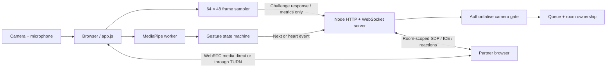

# Architecture and trust boundaries

## Components

Video/audio do not pass through the signaling server. Landmark inference and 64×48 frame analysis stay in the browser. No frames, landmarks or chat recordings are stored. WebRTC peers may learn each other's network addresses; production can use relay-only ICE and TURN if peer IP exposure is unacceptable. The starter does not imply anonymity.

## Gesture finite-state machine

`idle → swipe-dwell → swipe-armed → cooldown → idle` and `idle → heart-dwell → cooldown → idle`.

Each update uses a monotonic inference timestamp. Duplicate/out-of-order updates are ignored; gaps over 250 ms restart recognition. Hands disappearing, vertical movement over 9% of frame height, or a single-frame jump over 16% of frame width cancel a swipe. Holding a pose never emits a skip. Stable dwell lasts 180 ms; displacement must reach 18%, in 80–900 ms, with average speed at least 0.3 frame widths/second. Finger extension and togetherness are relative to palm scale. Two hands suppress swipe recognition, avoiding a heart being mistaken for a skip.

Heart geometry checks paired index tips and thumb tips, top-to-bottom separation and left/right palm positions. It is a conservative landmark heuristic, not a trained heart classifier. It requires 500 ms dwell. Cooldowns are 1600 ms for skip and 2500 ms for heart, plus a 200 ms neutral/release interval before rearming. A held heart triggers once. Session/visibility changes reset the machine, and stale worker results are ignored. Worker failures leave manual controls usable.

Real hand sizes, occlusion, mobility, camera FOV and device inference rates need calibration. Tune geometry and timing with representative recordings (with consent), preserve the false-positive tests, and expose accessible buttons rather than assuming every person can make these shapes.

The pinned MediaPipe release loads its WASM runtime via `importScripts`. A classic dedicated worker loads the package's CommonJS bundle into an isolated `self.exports` object; this avoids the module-worker `self.import` failure without rewriting vendor files or enabling `unsafe-eval`. GPU creation falls back to CPU. The model installer verifies a pinned SHA-256 digest. Keep the browser smoke test when changing MediaPipe versions.

## Camera-health state machine

`off/recovering → ready → warning → paused → recovering → ready`.

- Local camera permission acquisition is verified by obtaining the actual stream. The sample includes track `readyState`, `enabled`, `muted`, decoded frame count/age, luminance mean, variance and motion. Sampling runs every 500 ms. A `requestVideoFrameCallback` counter provides advancement, with a `currentTime` fallback. Permission revocation normally ends/mutes the track; track events and polling both handle this.
- The server sends a random one-use challenge roughly every two seconds. It expires in 4.5 seconds. Responses require strictly increasing sequence numbers and bounded finite metrics. Invalid responses never extend the health lease. Seven seconds without a valid heartbeat invalidates eligibility.
- New sessions cannot queue until three seconds of healthy reports. Off, disabled, ended, muted or permission-missing camera reports immediately revoke eligibility and end any room. The local UI also stops immediately on detected track loss; it is not the authority.
- Very dark frames (`mean < 5` AND `variance < 2`), old frames over 4 seconds, a stalled counter, or no measured motion for 15 seconds produce a warning. An already eligible conversation may continue for 120 seconds from the first unhealthy observation. A new/unready camera cannot enter matching during this grace period. New matching is denied while warning/recovering even if an existing call retains its grace.
- The server uses its own monotonic clock; there are no client-supplied timeout timestamps. It independently expires the grace on its 500 ms tick. Three seconds of sustained healthy reports are required to clear the unhealthy timer; a single bright flash does not clear it. Short reconnects retain that timer and reset initial eligibility until new camera checks pass.
- Dim-room mode changes the black threshold to `mean < 1.5` AND `variance < 0.7`. Pure black/stalled frames still fail. Motion is supporting evidence, not a proof of life. Noise, still people, backgrounding and poor lighting can all produce false positives/negatives. Provide lighting/restart instructions and manual resume without relaxing checks to “always healthy.”
- After a camera violation the user resumes explicitly once checks pass. A signaling reconnect gets fresh checks and may requeue the prior chat intent; it never restores an old room. Hiding the page pauses a live/searching session to avoid background inference/heartbeat ambiguity.

The two-minute threshold is measured from observed unusability, not the instant a physical lens becomes blocked. Sampling and heartbeat cadence add detection latency; frozen-image detection has a 15-second observation window. This is documented rather than advertised as exact physical-camera attestation.

## Server authority and security

HTTP-only SameSite=Strict session cookies use 256-bit randomness, Secure and `__Host-` in HTTPS deployments. WebSocket upgrades require an exact configured Origin, a known cookie and no existing connection for that session. Cookies live for the browser session; inactive server state is retained for ten minutes. Closing and reopening a socket preserves the health object but invalidates the lease. Anonymous users can clear cookies, and in-memory state does not survive a server restart.

The server owns the queue, room IDs, partner mapping, nonce, eligibility timers and reaction seed/ID. Pairing selects randomly among eligible waiting partners and rechecks both cameras; each signal/reaction checks room membership and both camera leases. There are no arbitrary target-user IDs. Old-room messages fail. Skipping tears down the old room before requeue and avoids the same partner for 15 seconds. The client serializes offer/answer processing and buffers early ICE candidates. Connection failure pauses; transient peer disconnect gets eight seconds to recover; initial negotiation times out after twenty seconds. WebSocket reconnection uses capped exponential backoff with jitter and fresh negotiation.

Limits: 64 KiB WebSocket payload; 48,000-character SDP; 4,096-character ICE candidate; 80-message burst plus 20 messages/sec per session; 80-signal burst plus 10/sec; reactions burst two then one per 2.5 seconds; skip one per 1.6 seconds. Excess packets are not forwarded. Slow receiver buffers above 256 KiB disconnect. Binary/malformed JSON closes after three violations. IP admission is burst 30 then one per two seconds, bounded to 10,000 address records and 5,000 sessions. A proxy must supply its own trusted rate-limit strategy: this server deliberately does not trust arbitrary `X-Forwarded-For` headers. Multiple users sharing an IP may encounter admission limits.

Reaction events contain only type, room, kind, server ID and seed. The rendering count, colors and durations are local fixed code; the sender cannot request millions of particles or inject markup. The renderer deduplicates IDs, caps live particles at 180 and uses fewer, stationary fading hearts for reduced motion. Video remains visible under the transparent canvas.

## What the server cannot know

A challenge proves a response is fresh from the connected client, not that its camera measurements are honest. Script-modified clients can claim healthy frames while sending black video. Physical/virtual cameras and prerecorded streams are generally indistinguishable through these APIs. A peer can also lie about remote quality. Peer-to-peer WebRTC means the signaling server cannot forcibly stop an already-established media path between two malicious clients; conforming clients close it on room termination.

Stronger policies need an authenticated identity model, server-side media observation through an SFU/relay, privacy-reviewed moderation and possibly randomized liveness challenges. Even these do not make absolute anti-bypass possible. They are outside this local starter's implementation, not hidden claims of protection.

## File map

| Path | Responsibility |
| --- | --- |
| `shared/gestures.js` | Landmark geometry, dwell, trajectory, cooldown/release FSM |
| `shared/health.js` | Frame metrics, metric validation, authoritative health FSM |
| `server/matchmaker.js` | Pairing, leases, room ownership, rate limits, message validation |
| `server/index.js` | HTTP, same-origin cookie sessions, bounded WebSocket transport |
| `public/app.js` | UI/session lifecycle, WebRTC, ordered signaling, controls |
| `public/camera.js` | Frame acquisition and local health sampling |
| `public/hand-worker.js` | Local MediaPipe inference off the main thread |
| `public/reactions.js` | Transparent deterministic neon-heart rendering |
| `tests/` | Gesture/health/server, real transport and Chrome smoke coverage |
