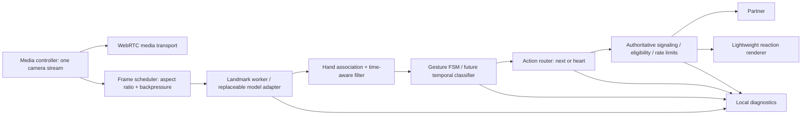

# Flippy: research, architecture and launch plan

Research checked on 11 November 2026. This document distinguishes published capabilities, engineering recommendations and evidence actually collected in this workspace. It is not an exhaustive survey of the entire internet and does not claim flawless recognition.

## निर्णय / Recommendation

Flippy के लिए **TypeScript + browser WebRTC + MediaPipe Hand Landmarker in a worker** सबसे practical starting point है. Python को offline data evaluation/training के लिए रखें. नई language चुनने से hand detection अपने-आप accurate नहीं होगा: input quality, temporal recognition, false-trigger testing और real-device evaluation निर्णायक हैं.

Existing runtime remains JavaScript in this iteration. We improved it incrementally instead of replacing a functioning call stack. A strict TypeScript migration is a staged engineering recommendation below, not a claim that every current file has already been converted.

For the first two gestures, keep a small explicit time-based state machine. A single-frame Victory/two-finger classification cannot establish a swipe. A two-hand heart needs the relationship between both hands; do not confuse it with MediaPipe's one-hand `ILoveYou` category. The built-in Gesture Recognizer's documented canned labels do not provide this application's dynamic swipe or its two-hand heart. [Google Gesture Recognizer](https://developers.google.com/edge/mediapipe/solutions/vision/gesture_recognizer?tab=Web).

## What the research supports

| Primary source | Relevant evidence | Flippy decision and limitation |
| --- | --- | --- |
| [MediaPipe Hand Landmarker documentation](https://developers.google.com/edge/mediapipe/solutions/vision/hand_landmarker?tab=Web) | Multiple hands, 21 points, handedness and image/world coordinates | Keep the existing on-device tracker and two-hand output. A vendor device benchmark is not a Flippy browser/device measurement. |
| [MediaPipe Hands paper, 2020](https://arxiv.org/abs/2006.10214) | Palm detector plus hand-landmark pipeline designed for on-device RGB tracking | Separate hand localization from gesture intent. This paper does not establish equal performance across our user groups. |
| [Casiez, Roussel & Vogel, CHI 2012](https://gery.casiez.net/publications/CHI2012-casiez.pdf) | Speed-adaptive low-pass filtering trades jitter against lag | Use timestamp-aware One Euro filtering, associate hands spatially, reset across tracking loss. Parameters still need recorded-data tuning. |
| [IPN Hand, 2020](https://arxiv.org/abs/2005.02134) | Continuous gestures mixed with ordinary non-gesture motion under varied illumination/backgrounds | Evaluate natural conversation and negatives, not only carefully posed positive examples. Dataset gestures/population are not a substitute for Flippy's target users. |
| [HaGRID repository](https://github.com/hukenovs/hagrid) | A substantial hand-gesture image dataset and maintained training resources | Useful for comparing pose recognition and negative classes. Static images cannot certify swipe timing. Check license/version and exact class definitions before use. No dataset was downloaded or training run here. |
| [Skin-tone annotation study, 2023/revised 2024](https://arxiv.org/abs/2305.09073) | Perceived skin-tone annotation depends on lighting and annotator perspective | Do not infer a user's race or adjust rules by race. Use consented evaluation cohorts, trained annotation where needed, and record lighting separately. This is annotation research, not a hand-tracking fairness benchmark. |
| [ONNX Runtime Web](https://onnxruntime.ai/docs/get-started/with-javascript/web.html) / [WebGPU guidance](https://onnxruntime.ai/docs/tutorials/web/ep-webgpu.html) | Different execution providers and a WASM alternative; WebGPU depends on browser support | Candidate runtime for a later custom temporal classifier. Feature-detect and benchmark; do not require WebGPU on every supported phone. |
| [Playwright emulation](https://playwright.dev/docs/emulation) | Browser viewport, touch, device and permission emulation | Useful automated UI coverage. A 390-pixel Chromium viewport is not a real iPhone or proof of Safari camera behavior. |
| [WebRTC TURN guide](https://webrtc.org/getting-started/turn-server) | Relays are needed when direct peer connectivity is unavailable | Production needs authenticated TURN and cross-network tests. Adding many STUN URLs alone does not solve every network. |
| [TypeScript migration guide](https://www.typescriptlang.org/docs/handbook/migrating-from-javascript.html) | Incremental JavaScript/TypeScript migration | Introduce strict shared contracts and migrate one ownership boundary at a time. Avoid a full rewrite while the test baseline is growing. |

## Five senior-engineer perspectives

These are five complementary review roles, not a fabricated ranking of individuals.

1. **Computer vision:** Is the hand found? Does identity remain stable when the two result entries reorder? Does smoothing delay a fast swipe? Are tracking loss and false-positive negatives measured? Owns the recognition dataset and versioned model/threshold evaluation.
2. **Realtime systems:** Does one accepted gesture produce one authoritative action? Can old-room events, replayed heartbeat challenges or reconnects create the wrong partner? Owns room lifetime, leases, limits, signaling and TURN tests.
3. **Product/UX:** Can a first-time user understand what to do without a technical tutorial? Can they leave immediately? Owns familiar call layout, stable controls, gesture guidance and manual equivalents.
4. **Browser/performance:** Do media capture, inference and effects compete for a mobile GPU? Owns worker backpressure, portrait geometry, p95 latency, thermal sessions and degraded-mode behavior.
5. **Quality/fairness/security:** Is accuracy measured on unseen participants, devices and lighting, with consent and uncertainty reported? Are test controls isolated? Owns release gates and regression evidence.

## Technology candidates

| Candidate | Where it fits | Decision |
| --- | --- | --- |
| TypeScript/JavaScript + MediaPipe + WebRTC | Current cross-device website with small gesture vocabulary | Recommended baseline; existing modules can migrate gradually. |
| TypeScript + ONNX Runtime + custom sequence classifier | Larger vocabulary or measured heuristic failures after collecting labeled sequences | Evaluate later against the baseline on identical held-out data. More training/maintenance cost. |
| Kotlin + Swift + native tracking SDKs | Future native apps requiring tighter device integration | Separate clients; not a replacement for a website shared through a URL. |
| Rust/WASM plus browser UI | Profiled CPU hot spots, specialized image processing | Optional optimization after measurement; does not itself improve recognition or fairness. |
| Python inference server | Offline research, model training, controlled research experiments | Use Python offline first. Uploading every live frame adds latency, privacy and server-cost tradeoffs. |

Neither React nor a newer language is necessary to recognize a gesture. If the UI grows, Vite + React + strict TypeScript is a reasonable incremental UI layer; the recognition and WebRTC modules should remain independently testable.

## Target architecture

Keep camera ownership in one module. Sample the existing stream; do not request a second camera for tracking. Never queue a backlog of stale frames. Keep inference off the UI thread. A new effect must not open its own inference loop or take over the microphone. Record the model version, thresholds, device/browser and frame geometry when evaluating changes.

Recommended typed boundaries for migration:

- `LandmarkFrame`: monotonic timestamp, image dimensions, hands and backend timings. Handedness classification confidence must not be mislabeled as landmark accuracy.
- `GestureIntent`: action (`skip` or `heart`), recognized timestamp, gesture version and tracking epoch. No microphone actions.
- `SessionCommand`: current room context plus intent; buttons use the same router as gestures.
- `ReactionEvent`: server-generated event ID and seed; the renderer cannot bypass server acceptance or amplify arbitrary particle counts.
- `DiagnosticRecord`: bounded event history and aggregated timings; raw video is not collected by default.

Suggested repository boundaries when migrating: `client/media`, `client/vision`, `client/gestures`, `client/ui`, `shared/protocol`, `server/session`, `tools/lab`, `evaluation`. Avoid microservices until measured load justifies them. For multi-instance matching, use a shared authoritative room store/owner; simply starting multiple independent Node processes is insufficient.

## Gesture recognition design

**Swipe:** positive pose + stable dwell + horizontal displacement + direction/speed consistency + single emission + release. Never trigger from the pose alone. Maintain a neutral/non-gesture class. Prefer missing an ambiguous swipe to unexpectedly ending a good conversation. Measure both left/right direction, front/rear camera mirroring and portrait/landscape framing.

**Heart:** two independently tracked hands; relative finger-tip/palm geometry; sustained hold; release before another event. Curvature, foreshortening, partial occlusion and nonstandard hand shapes require real examples. Current thresholds are engineering heuristics, not a learned universally valid classifier.

**Tracking:** replaced smoothing by list index with nearest-wrist association and timestamp-aware filtering. Ambiguous/large jumps reset filters. This reduces a specific artificial blend problem but is not a general solution for every crossing/occlusion. The input resize now preserves portrait/landscape aspect ratio; maximum side is 640 pixels rather than distorting every image to 320×240. Adaptive scheduling responds to measured inference duration; no universal “5ms” claim is made.

**Future model experiment:** after collecting consented labeled sequences, compare the baseline against a small temporal CNN or similar lightweight classifier on normalized two-hand joints, velocities, missing-hand masks and relative palm geometry. Keep participant-separated train/validation/test splits. Include everyday non-gesture motion and transition segments. Evaluate CPU/WASM as well as accelerated execution. Promote a model only if it improves held-out recognition without unacceptable false skips or mobile latency. No custom model has been trained in this task.

## Fairness and real-device evaluation

Skin tone, illumination, exposure, background, camera quality and hand visibility can interact. Never equate skin tone with race; never infer either to decide who receives different product behavior. Consented audit metadata is separate from runtime logic. Use a standardized annotation protocol and diverse reviewers where skin-tone labels are necessary.

Start with a diverse pilot, for example 60–100 consenting participants, across supported device tiers and lighting. This is a recruitment planning range, not a statistically sufficient certification claim. Cover bright/dim/backlit/warm light, cluttered backgrounds, hand sizes, distance, left/right dominance, mobility needs, sleeves/jewelry and occlusion. Retain separate measures for camera-gate false pauses: a detector can look fair while a brightness gate disproportionately interrupts some users.

Split by participant, not random adjacent video frames. Also hold out devices and sessions. Report per-cohort sample sizes and confidence intervals; use participant-level resampling for repeated attempts. Do not hide a weak group behind a good overall average. Public hand datasets are supplementary, not evidence of equal treatment on Flippy.

## Proposed launch gates — not achieved results

| Measure | Proposed initial gate | Evidence required |
| --- | --- | --- |
| Unintended next/skip | <0.1 events per user-hour, with a 95% upper confidence bound under the threshold | Long natural-conversation negatives; zero events in a short demo is inadequate. Under a Poisson approximation, zero events need about 30 hours to get an upper bound of 0.1/hour; apply separately to reported strata and account for clustered sessions. |
| Intended swipe and heart | At least 98% observed success, lower 95% bound at least 95% on supported conditions | Participant-separated real-camera evaluation; report per gesture and cohort. |
| Cohort disparity | Investigate any >5 percentage-point gap; gate on uncertainty, not just point estimates | Matched device/lighting conditions and sufficient cohort samples. This is an internal engineering threshold, not a legal standard. |
| Inference speed | Target p95 ≤100 ms on a specified supported baseline device | 15–30 minute calls with video and reactions active; GPU/CPU fallback measured separately. |
| Action latency | Target p95 ≤200 ms from completed gesture to local command; dwell reported separately | Time-aligned local telemetry; partner/network latency is a separate measure. |
| Camera safety | No queue entry with an invalid lease; black-view expiry/recovery pass | Automated server tests plus actual black/covered/unplugged-camera sessions. |
| Cross-device calling | Every declared browser/device tier passes join, next, heart, leave and reconnect | Physical iOS Safari, Android Chrome, Windows/macOS browsers, tablet orientation and TURN-only paths. |

Unknown or unsupported conditions need a clear manual-button fallback. “All devices” cannot mean literally every browser, sensor, OS and lighting condition. Publish a supported matrix after testing.

## Delivery sequence

1. **Current foundation:** isolated local bot lab, labeled simulated partners, no bot-to-bot matching, familiar call UI, per-session diagnostics, aspect-preserving inference, One Euro filtering, one-use heartbeat fixes and regression tests.
2. **Evidence collection:** guided labeled gesture attempts and consented recordings, participant-separated data, genuine device/network matrix. Add true input-video replay tests using consented fixtures; fake moving test video does not exercise visual hand detection.
3. **TypeScript migration:** add strict compiler/build pipeline, migrate protocol and pure gesture modules first, then media/session controllers; preserve browser tests at each boundary. Add runtime schemas because TypeScript types do not validate network input.
4. **Model comparison:** tune baseline vs a lightweight temporal model, freeze thresholds against the held-out benchmark, document model/data versions and regression results.
5. **Staged release:** staff pilot → invited testers → limited production cohort. Monitor false-skip reports, camera pauses, latency and failed connections. Keep independently controlled gesture/effect flags and a rollback path.

The existing temporary Cloudflare URL was reachable during this task with the title “RGC · Random Gesture Chats”. It is a temporary access route, not proof of a production deployment. The new lab intentionally binds to loopback on a separate port; phone access to a future staging lab needs HTTPS, authentication and an explicit isolated test pool. Do not publicly tunnel its bot-control endpoint.
